<div align="center">





</div>

---

<table>
<tr>
<td width="60%" valign="top">

### `01 / OPERATOR FILE`

**Handle:** `ankush404error`  
**Base:** Meerut, India  
**Primary lanes:** Cybersecurity · AI · Full-stack engineering  
**Operating principle:** Curiosity without collateral damage.

I’m a Computer Science engineering student interested in the seams between systems: how applications communicate, where they fail, how models behave, and how good engineering makes products safer and more useful.

</td>
<td width="40%" valign="top">

### `02 / CURRENT DIRECTIVES`

- `> ` Practice web security in authorized labs
- `> ` Build AI-powered tools with practical value
- `> ` Sharpen Java, DSA, Linux, and networking
- `> ` Ship, measure, improve, repeat

</td>
</tr>
</table>

## `03 / THE WORKBENCH`

<div align="center">

[](https://skillicons.dev)

</div>

| Unit | Tools / focus |
|---|---|
| **APPLICATION SECURITY** | HTTP, Burp Suite, secure coding, threat modeling, authorized testing |
| **AI SYSTEMS** | Python, Gemini API, ONNX, browser-side inference, ML pipelines |
| **BACKEND & APPS** | Java, Spring Boot, Flask, REST APIs, MongoDB, Android |
| **AUTOMATION** | n8n, integrations, workflow design |
| **CORE** | DSA, Java Collections, Linux, networking, Git |

## `04 / CASE FILES`

<details>
<summary><code>CASE-001</code> — NESTER / DOMAIN-AWARE SOCIAL PLATFORM</summary>

A community platform concept with global and official-domain feeds, stories, capsule posts, verification, and profile analytics.

**Stack:** React · Node.js · Express · MongoDB · Socket.IO

</details>

<details>
<summary><code>CASE-002</code> — DEARONE / PERSONAL REMINDER APP</summary>

An Android app concept for important dates, notifications, and personalized wishes, designed around a local-first starting point.

**Stack:** Kotlin · Jetpack Compose · Android notifications

</details>

<details>
<summary><code>CASE-003</code> — SMART IMAGE SORTER</summary>

An image organization project combining an ML pipeline, Flask API, and event-based photo grouping.

**Stack:** Python · ML · Flask

</details>

<details>
<summary><code>CASE-004</code> — DADI / AI STORYTELLING</summary>

A generative-AI storytelling app concept for interactive creative experiences.

**Stack:** Gemini API · application development

</details>

<details>
<summary><code>CASE-005</code> — FASALSEVA / FARMER SUPPORT</summary>

A conversational assistant concept intended to make farming information easier to access.

</details>

<details>
<summary><code>CASE-006</code> — PRIVACY-FIRST VISION AGENT</summary>

Exploring lightweight, client-side ML inference with WebGPU, WebAssembly, and ONNX Runtime Web to reduce unnecessary data transfer.

</details>

> These are project summaries, not claims of production deployment. Check the linked repositories for current implementation and availability.

## `05 / TELEMETRY`

<div align="center">


</div>

<div align="center">

</div>

## `06 / NEXT OBJECTIVES`

```text
[ ] Get sharper at Java + data structures
[ ] Learn application security by testing in legal labs
[ ] Build privacy-aware AI features that solve real problems
[ ] Improve deployment, observability, and secure API design
```

## `07 / OPEN CHANNEL`

<div align="center">

[](https://github.com/ankush404error)
[](https://github.com/ankush404error?tab=repositories)

```text
CONNECTION CLOSED.
The best operator in the room is the one who knows what not to touch.
```

<sub>ETHICAL SECURITY • PRIVACY BY DESIGN • BUILD WITH INTENT</sub>

</div>
