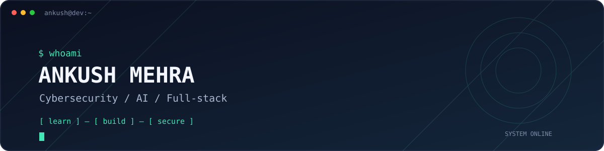
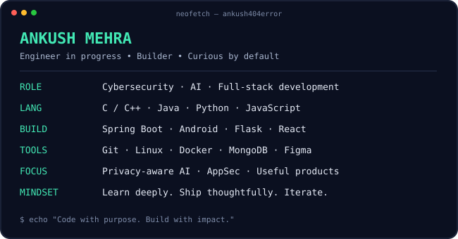

**Cybersecurity • AI Engineering • Full-Stack Development**

---

### `ankush@dev:~$ ./contributions.sh`

  

### `ankush@dev:~$ whoami`

<table>
<tr>
<td width="45%" valign="top">
  
</td>
<td width="55%" valign="top">
  
</td>
</tr>
</table>

## About Me

- 🎓 Computer Science engineering student who enjoys turning ideas into working software.
- 🛡️ Exploring cybersecurity, web application security, and privacy-conscious engineering.
- 🧠 Building with AI/ML, automation, backend systems, and Android.
- 🏆 Hackathon participant and winner; I enjoy solving practical problems with small, focused teams.
- 🔭 Currently sharpening my Java problem-solving, backend engineering, and security fundamentals.
- ⚡ Motto: **Code with purpose. Build with impact.**

## What I Build

| Project | What it explores |
|---|---|
| **Nester** | A community-oriented social platform with personal and official-domain feeds. |
| **DearOne** | An Android app for remembering important dates and sending thoughtful wishes. |
| **DaDi** | AI-powered storytelling using generative AI APIs. |
| **FasalSeva** | A conversational assistant concept for farmer support. |
| **Smart Image Sorter** | Image organization with an ML pipeline and Flask API. |
| **Privacy-preserving Vision Agent** | Browser-side ML concepts using WebGPU / WebAssembly and ONNX Runtime Web. |

> Project names describe work I've discussed or built; visit the repositories for their current implementation and status.

## Tech Stack

**Currently learning:** application security, Java collections and DSA, RAG systems, model deployment, and secure API design.

## GitHub Activity

  
  

  

## Let's Connect

  “Stay curious. Test assumptions. Build things that matter.”

